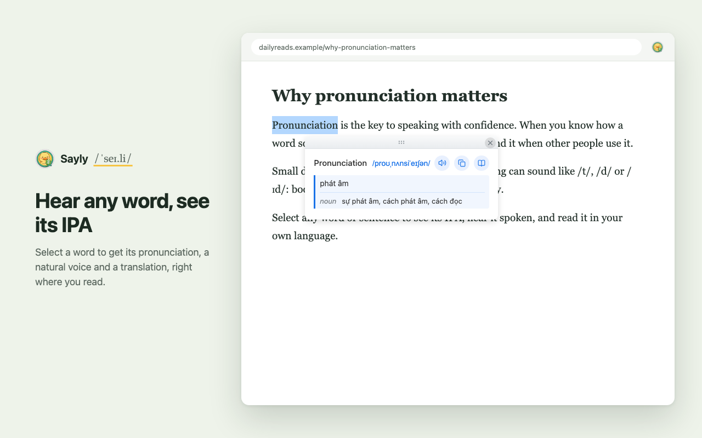
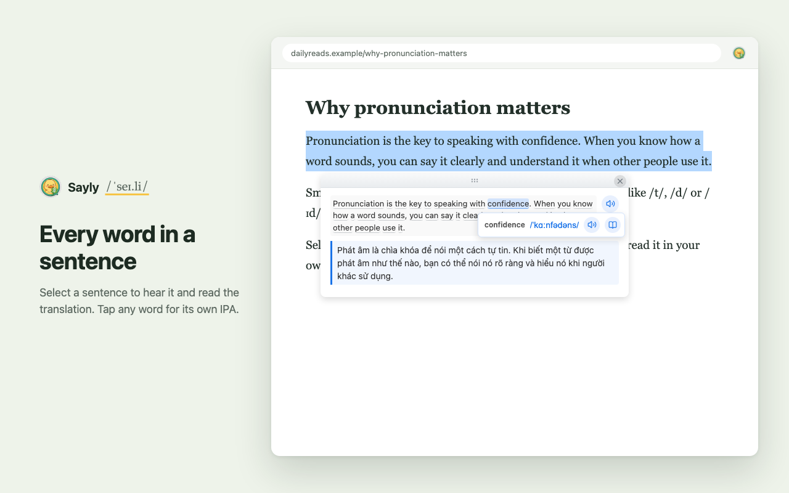
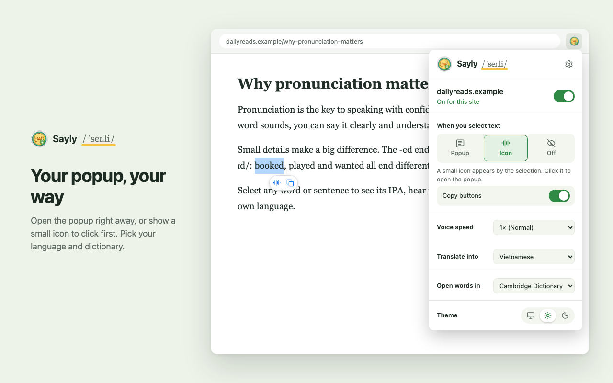
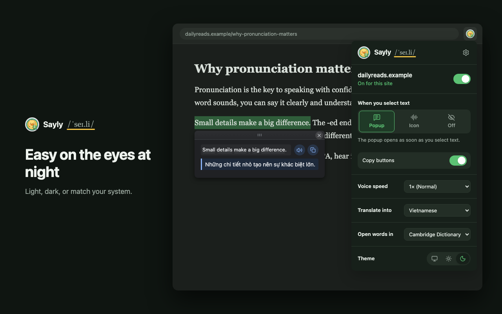

# Sayly – Pronunciation, IPA & Translate

> Select English text on any webpage to hear it spoken, see its IPA, and read a translation.

[](LICENSE)

[](https://cs-tungthanh.github.io/cs-tungthanh/sayly/)

Sayly is a browser extension for English learners. Highlight a word, a sentence or a whole paragraph and a small popup shows how each word is pronounced, plays it aloud, and translates it into your language.

**[Try it on the Sayly website →](https://cs-tungthanh.github.io/cs-tungthanh/sayly/)**



## Features

- **Hear it** – play the whole selection or a single word, at 0.5× to 1.5× speed
- **IPA for every word** – American English transcriptions from the bundled CMU Pronouncing Dictionary (~126,000 words), so most lookups never leave your browser
- **Translate** – into 34 languages (Vietnamese by default), with meanings by part of speech when you select a single word
- **Dictionary link** – open a word on Dictionary.com or Cambridge Dictionary
- **Copy** – one click copies a word with its IPA, or a selection with its translation
- **Your choice of trigger** – open the popup as soon as you select, show a small icon to click first, or turn it off
- **Per-site switch** – turn Sayly off on sites where you don't want it
- **Voices** – Microsoft's natural voice in Edge, Google's voice elsewhere, or any voice installed on your system
- **Light and dark themes**, or follow the system
- **Draggable popup** – move it out of the way; press Esc or click outside to close

| Sentence | Settings | Dark |
|---|---|---|
|  |  |  |

## Install

Sayly is not in the Chrome Web Store yet. To install it from source:

```bash
git clone https://github.com/cs-tungthanh/sayly.git
cd sayly
pnpm install
pnpm build
```

Then open `chrome://extensions` (or `edge://extensions`), turn on **Developer mode**, click **Load unpacked** and choose the `dist/` folder.

## Usage

1. Select text on any page. The popup opens next to it (or an icon appears, depending on your setting).
2. Press play to hear the selection, or click a word to hear just that word and see its IPA.
3. Drag the popup by its handle to move it. Press Esc or click outside to close.

Quick settings (trigger, speed, translation language, theme, on/off for the current site) are in the toolbar popup. **All settings** opens the full page, which adds the voice picker and the list of disabled sites.

## Privacy

Sayly collects no data and has no analytics. Pronunciation and IPA work locally for words in the bundled dictionary. These requests do leave your browser:

- Words missing from the dictionary go to the [Free Dictionary API](https://dictionaryapi.dev/).
- Translated text goes to Google Translate, or MyMemory if Google fails. Set translation to **Off** to stop this.
- Spoken text goes to Google's text-to-speech; if that fails, the browser's built-in voice is used.

See [PRIVACY.md](PRIVACY.md) for the full policy.

## Development

```bash
pnpm dev           # build and rebuild on change into dist/
pnpm dev:edge      # same, and run it in Microsoft Edge with auto-reload
pnpm type-check    # TypeScript check
pnpm build         # production build into dist/
pnpm build:zip     # production build packed as sayly.zip
pnpm cmudict       # regenerate src/data/cmudict-ipa.txt from the CMU dictionary
```

Built with TypeScript and Vite. The code lives in `src/`:

| Folder | What's there |
|---|---|
| `content/` | Content script injected into pages; listens for selections |
| `ui/` | Popup building, dragging, selection handling |
| `background/` | Service worker: IPA lookup, translation, caches |
| `offscreen/` | Hidden page that plays Google TTS audio so sites can't block it |
| `api/` | CMU dictionary, Free Dictionary API, Google Translate / MyMemory, Google TTS clients |
| `speech/`, `text/` | Speech playback and text processing (contraction expansion etc.) |
| `popup/`, `options/` | Toolbar popup and settings page |
| `constants/`, `shared/` | Config values, UI strings, helpers |

[CONTEXT.md](CONTEXT.md) defines the terms used in the code, and [ARCHITECTURE.md](ARCHITECTURE.md) describes how the modules fit together.

### How IPA is found

1. Contractions are expanded first (*doesn't* → *does not*).
2. Each word is looked up in the bundled CMU dictionary.
3. Inflected forms it doesn't list are built from the base word: *-ed* → /t/, /d/ or /ɪd/; *-s* → /s/, /z/ or /ɪz/; *-ing* → /ɪŋ/.
4. Anything still unknown falls back to the Free Dictionary API. Results are cached in the background worker.

## Releasing

Releases go through GitHub Actions:

- **Release Extension** (manual) bumps the version (patch, minor or major), tags it, and optionally publishes to the Chrome Web Store.
- **Bump Version** (manual) only bumps the version, commits and tags it.
- **Publish to Chrome Web Store** runs on `v*` tags: type-checks, builds, uploads the ZIP and creates a GitHub release.

To bump locally instead, run `pnpm version:patch` (or `:minor` / `:major`), commit, tag `vX.Y.Z` and push the tag.

Setting up the Chrome Web Store credentials and GitHub secrets is covered in [docs/CICD_SETUP.md](docs/CICD_SETUP.md).

## Contributing

Issues and pull requests are welcome. When reporting a bug, include your browser and version, the page where it happened, and steps to reproduce. Before opening a PR, run `pnpm type-check` and try the change on a few different sites.

## License

[MIT](LICENSE)

## Acknowledgments

- [CMU Pronouncing Dictionary](https://github.com/cmusphinx/cmudict), Copyright (C) 1993-2015 Carnegie Mellon University. Its license ships with the extension as `CMUDICT-LICENSE.txt`.
- [Free Dictionary API](https://dictionaryapi.dev/) for words outside the bundled dictionary.
